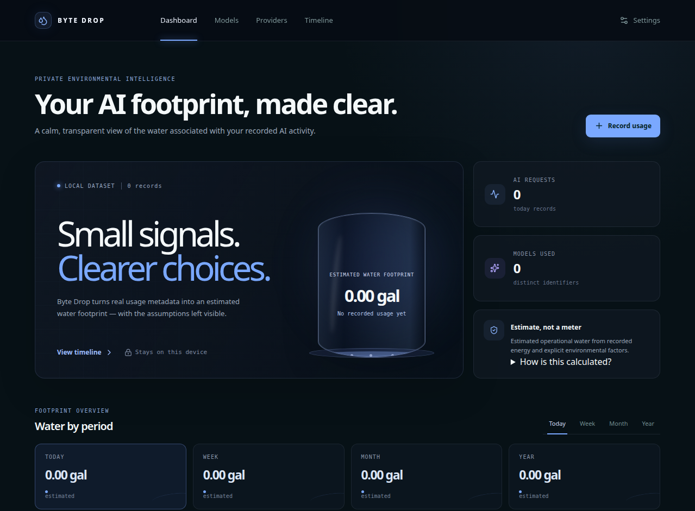
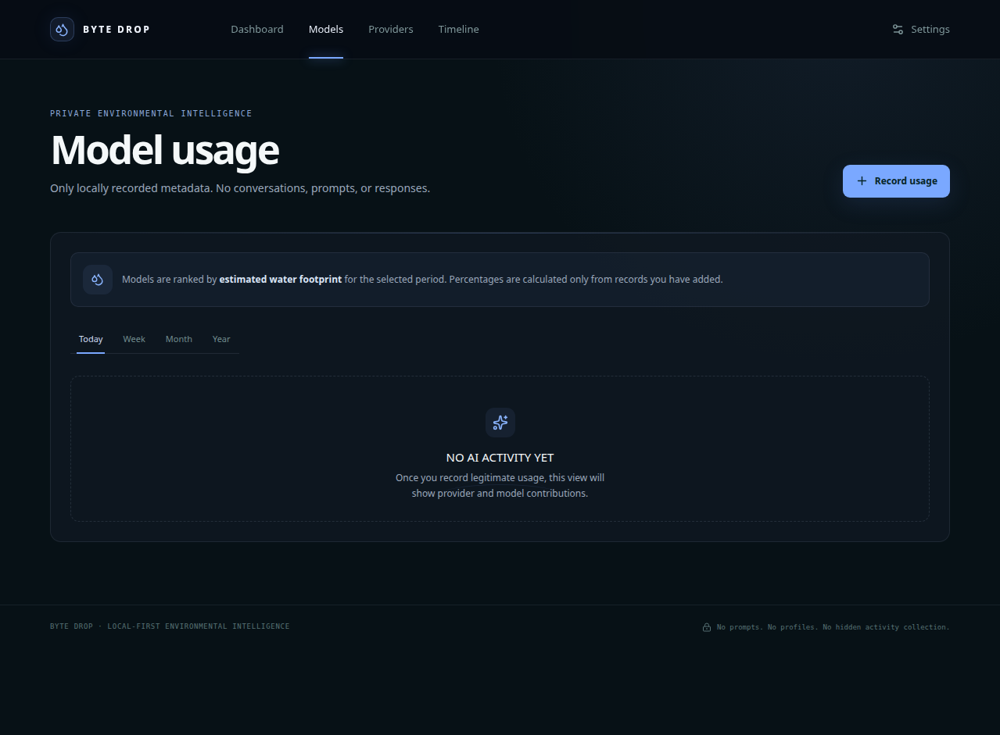
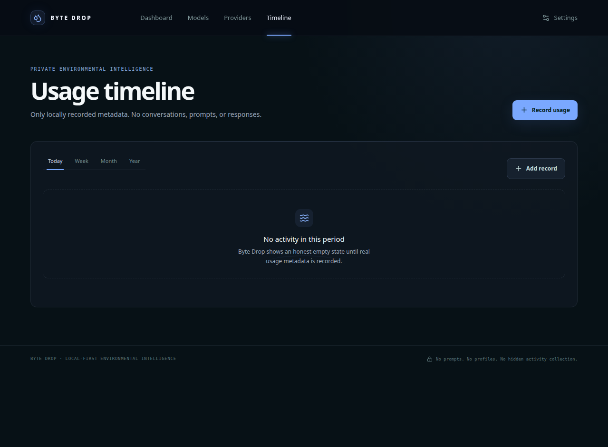

# Byte Drop

> A local-first dashboard for recording AI usage metadata and making estimated operational water impact easier to understand.

Byte Drop is a standalone, privacy-focused application that records **AI usage metadata** and presents an **estimated operational water footprint**. It is an estimation tool, not a physical water meter.

The project is designed around a simple principle: keep the data local, keep the assumptions visible, and avoid collecting information that is not required for the calculation.

## Screenshots

### Dashboard



### Model usage



### Usage timeline



## Highlights

- Local-first operation with SQLite persistence.
- No account, cloud database, analytics, telemetry, advertising, or tracking requirement.
- Stores normalized usage metadata rather than prompts, responses, transcripts, private files, credentials, or unrelated computer activity.
- Server-side provider adapters with strict endpoint, timeout, response-size, and schema controls.
- Security headers, API-only CORS allowlisting, bounded request parsing, validation, rate limiting, and privacy-safe error handling.
- Versioned calculation metadata so historical estimates are not silently recalculated.
- Honest empty states: the dashboard does not invent or seed usage activity.

## Requirements

- **Node.js 22 or newer**
- **pnpm 10.4.1 or newer**

The default database is a local SQLite file at `file:../byte-drop.local.db` when `DATABASE_URL` is not supplied.

## Quick start

### macOS / Linux

```bash
cp env.example .env
pnpm install --frozen-lockfile
pnpm prisma generate
pnpm prisma migrate deploy
pnpm dev
```

### Windows Command Prompt

```cmd
copy env.example .env
pnpm install --frozen-lockfile
pnpm prisma generate
pnpm prisma migrate deploy
pnpm dev
```

Then open:

```text
http://localhost:3000
```

The server binds to `127.0.0.1` by default. Keep `.env` untracked and never place real secrets in frontend-exposed variables.

## Production build

```bash
pnpm install --frozen-lockfile
pnpm prisma generate
pnpm prisma migrate deploy
pnpm build
pnpm start
```

The production process serves the built client and local API. Development HMR is not enabled in production.

For an intentionally non-local deployment, set `HOST` explicitly and review `SECURITY.md` before exposing the service to a network.

## Environment configuration

`DATABASE_URL` is optional. When omitted, Byte Drop uses:

```text
file:../byte-drop.local.db
```

Optional provider configuration follows this server-only pattern:

```text
BYTE_DROP_PROVIDER_<PROVIDER>_ENDPOINT
BYTE_DROP_PROVIDER_<PROVIDER>_API_KEY
```

Provider API keys are server-side secrets. They are not placed in React state, browser storage, cookies, URLs, query parameters, HTML, database records, logs, or error messages.

Provider endpoints are subject to the application's documented-host and HTTPS policy. Local model endpoints must be explicitly configured literal loopback addresses such as `127.0.0.1` or `[::1]`.

## How the water estimate works

Byte Drop uses an energy-first operational water model:

> **Operational water consumption (liters) = IT energy (kWh) × [onsite WUE (L/kWh) + (PUE × offsite electricity water intensity (L/kWh))]**

Gallons are a display conversion from liters.

Token-only records use an explicitly labeled low-confidence engineering energy fallback. Byte Drop does **not** claim that one token or one AI request has a universal water value.

Embodied water is excluded from operational totals.

Methodology context and source material are documented in [`docs_methodology_sources.md`](docs_methodology_sources.md).

## Architecture

```text
Browser (React)
       |
       | same-origin local API
       v
Express server
   |            |
   |            +--> optional server-side provider adapters
   |
   +--> validation / security boundaries
   |
   +--> calculation engine
   |
   +--> Prisma 7 + SQLite
```

Byte Drop is deliberately **not** a browser-side AI chat client. It records normalized usage metadata and calculates an estimated operational water footprint.

## Privacy and security

Byte Drop is designed for local single-user operation and minimum data collection.

Security controls include:

- Zod validation and bounded request bodies.
- JSON depth and collection-size limits.
- Bounded pagination and database queries.
- Rate limiting with expiration cleanup and bounded bucket storage.
- Privacy-safe application and provider errors.
- Security headers across API and static responses.
- Production Content Security Policy with same-origin resource restrictions.
- `X-Content-Type-Options: nosniff`.
- `X-Frame-Options: DENY`.
- `Referrer-Policy: no-referrer`.
- Restrictive Permissions Policy.
- Explicit API-only CORS allowlisting; no wildcard origin reflection.
- No required analytics, telemetry, tracking pixels, session recording, advertising, browser filesystem access, or clipboard reads.

See [`SECURITY.md`](SECURITY.md) for the threat model, security controls, release verification requirements, dependency posture, and vulnerability-reporting guidance.

## Testing and verification

Run:

```bash
pnpm install --frozen-lockfile
pnpm prisma generate
pnpm check
pnpm test
pnpm build
pnpm audit
pnpm audit --prod --audit-level high
```

The project includes automated tests covering calculation behavior, provider configuration, security boundaries, request handling, and related controls.

## Repository hygiene

The repository should contain source and documentation only.

Do **not** commit:

- `.env`
- local SQLite database files
- `node_modules`
- `dist`
- generated Prisma output
- logs
- caches
- temporary files
- secrets or API keys

The included `.gitignore` is configured for the local development artifacts above.

## License

Byte Drop is released under the proprietary license in [`LICENSE`](LICENSE).

Copyright © 2026 Jisnu Vardhan. All rights reserved.

The license permits personal, educational, evaluation, and non-commercial reference use, while commercial use, redistribution, sublicensing, and derivative distribution require separate written permission.

Third-party dependencies remain subject to their respective licenses.

## Security reporting

Please do not include secrets or private usage data in security reports.

See [`SECURITY.md`](SECURITY.md) for the reporting process and security policy.

---

**Byte Drop** — local-first environmental intelligence for AI usage.
